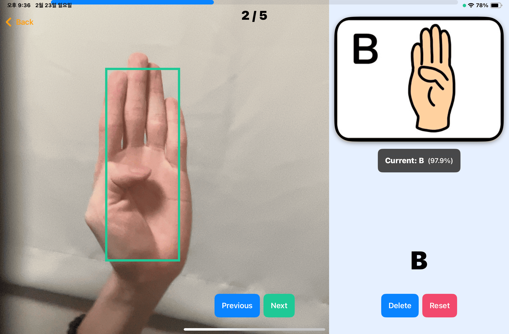

# Signy Play

> 카메라 앞에서 손 모양을 만들며 알파벳 수어(ASL)를 익히는 청각장애 아동용 퀴즈 앱

Signy Play는 알파벳을 처음 배우는 청각장애 아동이 미국 수어(ASL) 알파벳을 게임처럼 익히도록 돕는 iPad 앱입니다.
화면에 나온 알파벳이나 단어를 전면 카메라 앞에서 수어 손 모양으로 직접 만들어 보면, 앱이 손 모양을 인식해 맞았는지 바로 알려 줍니다.

WWDC25 Swift Student Challenge에 혼자 제출해 **Winner**로 선정된 작품입니다.

  

Swift Student Challenge 2025 Winner 선정 안내

## :fireworks: Screenshots

  

퀴즈 화면: 왼쪽 카메라에서 손을 찾아 표시하고, 오른쪽에 문제 카드와 지금 인식한 글자·확신도를 보여 줍니다

  
  

왼쪽: 퀴즈 고르기 시연 · 오른쪽: 손 모양으로 문제 풀기 시연

## :pushpin: 주요 기능

- **두 가지 퀴즈 주제**: A부터 Z까지 26개 알파벳 퀴즈와, Apple·Cat·Rainbow처럼 아이에게 익숙한 19개 영어 단어를 철자로 표현하는 단어 퀴즈 중에서 고릅니다.
- **문제 수 선택**: 한 번에 5개, 10개, 15개 문제 중에서 고르면 그만큼 문제가 무작위로 나옵니다.
- **카메라 손 모양 인식**: 전면 카메라에 손을 비추면 손 위치를 상자로 표시하고, 지금 어떤 글자로 인식했는지와 확신도(%)를 실시간으로 보여 줍니다.
- **손 모양을 유지하면 입력**: 같은 글자를 확신도 80% 이상으로 1초 동안 유지해야 답에 한 글자가 더해지므로, 손을 바꾸는 중에 잘못 입력되지 않습니다.
- **정답 피드백**: 만든 답이 문제와 같아지면 테두리가 초록색으로 바뀌고 2초 뒤 다음 문제로 넘어갑니다. 마지막 문제를 맞히면 처음 화면으로 돌아갑니다.
- **답 고치기와 문제 이동**: `Delete`로 마지막 글자를 지우고 `Reset`으로 처음부터 다시 만듭니다. `Previous`·`Next`로 문제를 오가고, 위쪽 진행 막대와 `2 / 5` 표시로 남은 문제를 확인합니다.

## :footprints: 사용 흐름

1. 첫 화면에서 **Alphabet** 또는 **Words** 카드를 누릅니다.
2. 문제 수(5·10·15개)를 고르고 **Start!** 를 누릅니다.
3. 오른쪽 카드에 나온 글자나 단어를 카메라 앞에서 수어 손 모양으로 하나씩 만듭니다.
4. 답이 맞으면 초록 테두리와 함께 다음 문제로 넘어가고, 모든 문제를 풀면 처음 화면으로 돌아옵니다.

## :sparkles: 기술 스택

  
  
  
  
  
  
  

- **SwiftUI**: 퀴즈 선택, 문제 카드, 진행 막대 등 모든 화면을 만듭니다.
- **AVFoundation**: 전면 카메라 영상을 받아 화면에 미리보기로 보여 줍니다.
- **Vision**: 카메라 프레임마다 손 관절 위치(hand pose)를 찾고 손 영역을 계산합니다.
- **Core ML · Create ML**: 손 관절 좌표를 입력으로 받는 손 모양 분류 모델을 Create ML로 학습해 앱에 넣었습니다.

## :trophy: 프로젝트 배경

- WWDC25 Swift Student Challenge 1인 제출작이며, Winner로 선정되었습니다.
- 개발 기간: 2025.01.31 - 2025.02.23
- 개발 환경: Xcode 16 App Playground(`SignyPlay.swiftpm`), iPadOS 16 이상
- 테스트 기기: iPad Pro(12.9형, 11형), iPad mini

## :books: 출처

- **손 모양 인식 모델**: [Kaggle ASL Alphabet 데이터셋](https://www.kaggle.com/grassknoted/asl-alphabet)으로 학습했습니다.
- **퀴즈 카드**: 문제에 쓴 수어 자료는 Google 검색으로 찾아 참고했고, Figma에서 카드 형태로 직접 디자인했습니다.

## :page_facing_up: 라이선스

[MIT License](LICENSE)
